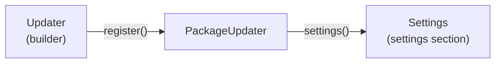

# Reference

This page covers the public API, which is in three types: the `Updater` builder, the `PackageUpdater` that the `register()` method returns, and the `Settings` object that the `settings()` method of the `PackageUpdater` returns. The `Settings` object is the updater-provided settings section. The page also covers the names that the updater derives from the consumer-provided prefix. The three types are in the `ScottOffen\WpGithubUpdater` namespace.

The following diagram shows how the three types connect. The `plugin()` and `theme()` methods return the `Updater`, and each arrow is labeled with the method that returns the next type.



## Summary

The following tables list the members of each type that this page describes. Each member name includes the type that the member belongs to.

### Updater

| Member | Description |
| --- | --- |
| [`Updater::plugin()`](#updaterplugin) | Starts the setup for a plugin. |
| [`Updater::theme()`](#updatertheme) | Starts the setup for a theme. |
| [`Updater::uninstall()`](#updateruninstall) | Removes the saved token and the stored state of the last check for a prefix. |
| [`Updater::fromGitHub()`](#updaterfromgithub) | Sets the repository that the releases are in. |
| [`Updater::prefix()`](#updaterprefix) | Sets the prefix that the names of the token constant and the options are derived from. |
| [`Updater::capability()`](#updatercapability) | Sets the capability that the settings section requires. |
| [`Updater::assetPattern()`](#updaterassetpattern) | Sets the pattern for the file name of the release asset. |
| [`Updater::register()`](#updaterregister) | Registers the update hooks and returns the updater. |

### PackageUpdater

| Member | Description |
| --- | --- |
| [`PackageUpdater::settings()`](#packageupdatersettings) | Returns the updater-provided settings section. |
| [`PackageUpdater::capability()`](#packageupdatercapability) | Returns the capability that the settings section requires. |

### Settings

| Member | Description |
| --- | --- |
| [`Settings::render()`](#settingsrender) | Prints the settings section on a page. |
| [`Settings::addPage()`](#settingsaddpage) | Adds a separate page for the settings section to the admin menu. |

## Entry Points

These methods are static methods of the `Updater` class.

### `Updater::plugin()`

```php
public static function plugin(string $file): Updater
```

Starts the setup for a plugin and returns the builder so that additional calls can be chained.

| Parameter | Type | Description |
| --- | --- | --- |
| `$file` | `string` | The main file of the plugin, which is `__FILE__` in that file. |

### `Updater::theme()`

```php
public static function theme(string $file): Updater
```

Starts the setup for a theme and returns the builder so that additional calls can be chained.

| Parameter | Type | Description |
| --- | --- | --- |
| `$file` | `string` | The `functions.php` file of the theme, which is `__FILE__` in that file. |

### `Updater::uninstall()`

```php
public static function uninstall(string $prefix): void
```

Removes the saved token and the stored state of the last check for a prefix. Nothing else is removed. A token constant in `wp-config.php` is not removed, and the saved token is removed even when a constant is defined. A plugin calls this method from its `uninstall.php` file. See [Removing the Token on Uninstall](./private-repositories.md#removing-the-token-on-uninstall).

| Parameter | Type | Description |
| --- | --- | --- |
| `$prefix` | `string` | The prefix that the plugin or theme was set up with. |

| Exception | Thrown when |
| --- | --- |
| `InvalidArgumentException` | The prefix is not lowercase letters, digits, and underscores that start with a letter. Nothing is removed. |

## Builder Methods

These methods belong to the `Updater` builder that the `plugin()` and `theme()` methods return. Each builder method returns the builder so that additional calls can be chained.

### `Updater::fromGitHub()`

```php
public function fromGitHub(string $repository): Updater
```

Sets the repository that the releases are in. The repository is required, and `register()` throws an exception when it was not set.

| Parameter | Type | Description |
| --- | --- | --- |
| `$repository` | `string` | The repository, written `owner/repository`. Replace `owner` with the user or organization that owns the repository, and `repository` with the name of the repository. |

### `Updater::prefix()`

```php
public function prefix(string $prefix): Updater
```

Sets the prefix that the names of the token constant and the options are derived from. The prefix is required, and `register()` throws an exception when it was not set. See [Names From the Prefix](#names-from-the-prefix).

| Parameter | Type | Description |
| --- | --- | --- |
| `$prefix` | `string` | A prefix of lowercase letters, digits, and underscores, starting with a letter. Each plugin and theme on a site must have its own prefix. |

### `Updater::capability()`

```php
public function capability(string $capability): Updater
```

Sets the capability that the settings section requires. The default is `manage_options`. See [Capability](./settings-section.md#capability).

| Parameter | Type | Description |
| --- | --- | --- |
| `$capability` | `string` | The capability, using letters, digits, underscores, and hyphens. |

| Exception | Thrown when |
| --- | --- |
| `InvalidArgumentException` | The capability is empty or has any other character. |

### `Updater::assetPattern()`

```php
public function assetPattern(string $pattern): Updater
```

Sets the pattern for the file name of the release asset. The default is `<slug>-*.zip`, where the slug is the name of the plugin or theme folder. See [Custom Asset Names](./packaging-and-releases.md#custom-asset-names).

| Parameter | Type | Description |
| --- | --- | --- |
| `$pattern` | `string` | A file name pattern, such as `exampleplugin-*.zip`. In the pattern, `*` stands for any run of characters, `?` stands for one character, and a set of characters in square brackets, such as `[0-9]`, stands for one character from the set. |

| Exception | Thrown when |
| --- | --- |
| `InvalidArgumentException` | The pattern is empty or has a slash. |

### `Updater::register()`

```php
public function register(): PackageUpdater
```

Registers the update hooks and returns the `PackageUpdater`. A second call on the same builder returns the updater from the first call.

| Exception | Thrown when |
| --- | --- |
| `LogicException` | `fromGitHub()` or `prefix()` was not called. |
| `InvalidArgumentException` | The repository is not written `owner/repository`, the prefix is not valid, the file of a plugin is not a PHP file, the plugin is not in a folder inside the plugins folder, the file of a theme is not `functions.php`, or the name of the folder is not a valid slug. |
| `RuntimeException` | The setup is for a plugin and the `WP_PLUGIN_DIR` constant is not defined as a string. |

## PackageUpdater Methods

These methods belong to the `PackageUpdater` that the `register()` method returns.

### `PackageUpdater::settings()`

```php
public function settings(): Settings
```

Returns the updater-provided settings section. See [Updater-Provided Settings Section](./settings-section.md).

### `PackageUpdater::capability()`

```php
public function capability(): string
```

Returns the capability that the settings section requires, which is `manage_options` unless the [`Updater::capability()`](#updatercapability) builder method set another one. Use it with `current_user_can()` to check the same capability on your own page.

## Settings Methods

These methods belong to the `Settings` object that the `PackageUpdater::settings()` method returns.

### `Settings::render()`

```php
public function render(string $heading = ''): void
```

Prints the settings section at the place where it is called. It prints nothing for someone who does not have the capability, and it must be called outside any `<form>` element. See [Show the Section on an Existing Page](./settings-section.md#show-the-section-on-an-existing-page).

| Parameter | Type | Description |
| --- | --- | --- |
| `$heading` | `string` | A heading that appears above the section. The default is no heading. |

### `Settings::addPage()`

```php
public function addPage(string $title, string $parent): void
```

Adds a separate page for the settings section to the admin menu. The updater adds the page when WordPress builds the admin menu, so call the method when the plugin or theme loads. See [Add a Separate Page](./settings-section.md#add-a-separate-page).

| Parameter | Type | Description |
| --- | --- | --- |
| `$title` | `string` | The title of the page, which is also the label of its menu entry. |
| `$parent` | `string` | The slug of the admin menu to add the page under. The slug `options-general.php` adds the page under Settings, and `themes.php` adds it under Appearance. |

| Exception | Thrown when |
| --- | --- |
| `InvalidArgumentException` | The title or the parent is empty. |

## Names From the Prefix

The following table describes the names that the updater derives from the prefix. In the table, `<prefix>` is the prefix in lowercase and `<PREFIX>` is the prefix in uppercase. The last column shows the names for the prefix `exampleplugin`.

| Name | Description | For `exampleplugin` |
| --- | --- | --- |
| `<PREFIX>_GITHUB_TOKEN` | The constant where the token can be defined. See [Configuring the Token](./private-repositories.md#configuring-the-token). | `EXAMPLEPLUGIN_GITHUB_TOKEN` |
| `<prefix>_updater_github_token` | The option where the saved token is stored. | `exampleplugin_updater_github_token` |
| `<prefix>_updater_release_state` | The option where the state of the last check is stored. | `exampleplugin_updater_release_state` |
| `<prefix>_updater_settings` | The slug of the page that `addPage()` adds. | `exampleplugin_updater_settings` |
